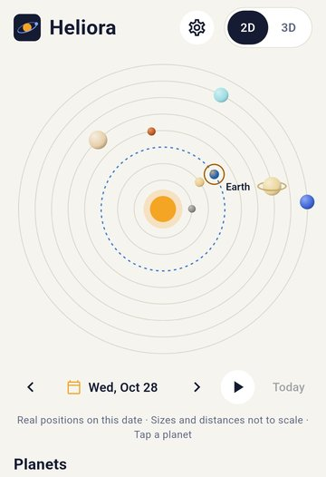
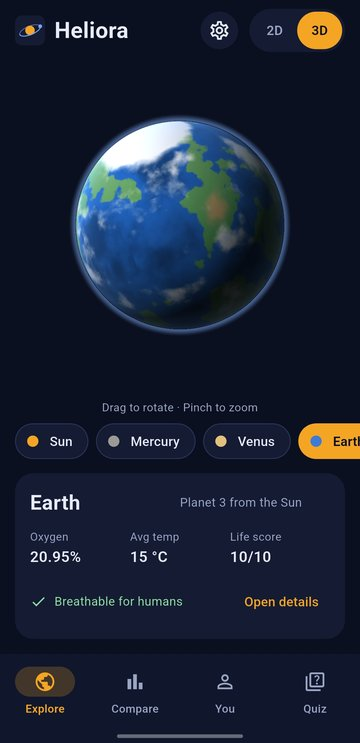
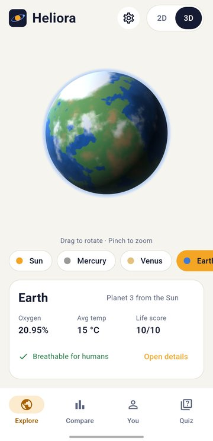
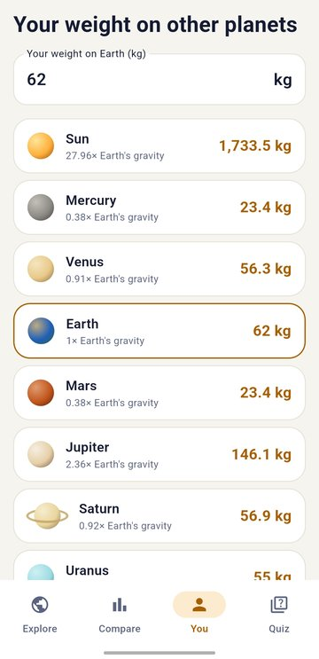
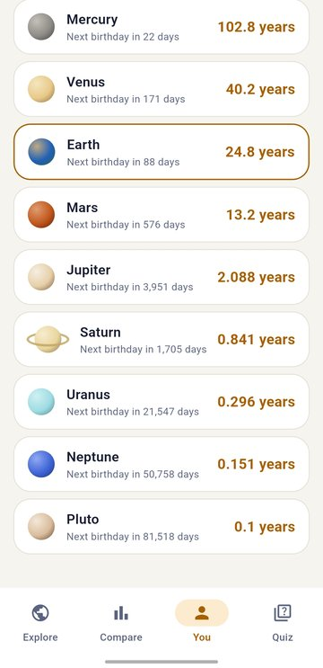
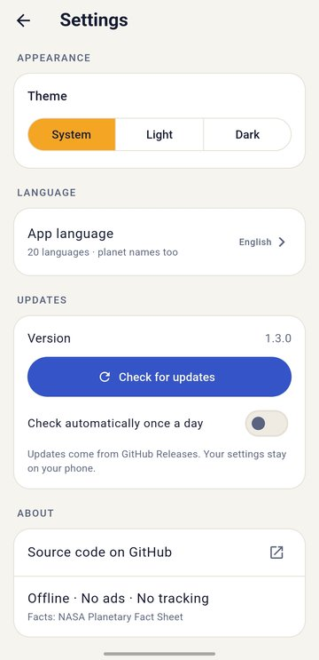

<div align="center">


# Heliora

**Explore the Solar System, fully offline.**

Real planet positions, rotating 3D worlds, atmospheres and oxygen,<br>
and an honest answer to "could humans live here?"

[](https://github.com/lumio-apps/heliora/releases/latest)
[](https://github.com/lumio-apps/heliora/releases)
[](LICENSE)


[**⬇ Download the latest APK**](https://github.com/lumio-apps/heliora/releases/latest)

</div>

---

## Screenshots

<table>
  <tr>
    <td align="center"><br><sub>Real positions today</sub></td>
    <td align="center"><br><sub>3D worlds, dark mode</sub></td>
    <td align="center"><br><sub>3D worlds, light mode</sub></td>
  </tr>
  <tr>
    <td align="center"><br><sub>Your weight everywhere</sub></td>
    <td align="center"><br><sub>Your age on other planets</sub></td>
    <td align="center"><br><sub>Theme, 20 languages, updates</sub></td>
  </tr>
</table>

## Features

### 🪐 Explore
- **2D map with real positions.** Every planet sits where it really is around the Sun today. Pick any date from 1800 to 2050, step 30 days back or forward, or press play and watch the planets move.
- **3D worlds.** Rotate and zoom every body with your finger: Earth with moving clouds, Jupiter's Great Red Spot, Saturn's rings, the glowing Sun and the cracked ice of Europa.
- **18 worlds.** The Sun, all 8 planets, Pluto, our Moon and 7 famous moons: Io, Europa, Ganymede, Callisto, Titan, Enceladus and Triton.

### 🌙 Tonight's sky
- **Which planets can I see tonight?** Pick your city (no location permission) and Heliora tells you which planets are up after dark, the best time to look, the direction and how high, plus rise and set times.
- **The Moon tonight.** Phase, how much of it is lit, moonrise and moonset, and the dates of the next full and new moon.
- **Sunset and sunrise** for your city.
- **Find it with your compass.** Tap the compass button next to the Moon or a planet, hold your phone up, and Heliora shows which way to turn and tilt until you are pointing right at it. It uses your phone's motion sensors only: no camera, no location.

### 🌍 Learn
- **Planet facts.** Diameter, gravity, temperature, length of day and year, known moons, distance from the Sun and surface pressure.
- **Atmosphere and oxygen.** What each atmosphere is made of, and how its oxygen compares with Earth's.
- **Could humans live here?** A simple 0 to 10 life score for every world, worked out from temperature, air pressure, oxygen, water, surface and gravity. Earth scores 10, Mars 4, Jupiter 0.
- **How far is it?** Today's real distance from Earth, and how long light, a spacecraft or a car would need to get there.
- **Compare.** Any two worlds side by side, with their true sizes drawn next to each other.

### 🙋 You
- **Your weight** on every world, from the Moon to the Sun.
- **Your age on other planets** and the date of your next birthday there.
- **Quiz.** 10 questions built from the planet data, with your best score saved.
- **Share.** Turn a planet's card into a picture and send it to your friends.

### ⚙️ Made for everyone
- **Light, dark or system theme.**
- **20 languages:** English, Hindi, Bengali, Gujarati, Kannada, Malayalam, Marathi, Punjabi, Tamil, Telugu, Urdu, Arabic, Chinese, Japanese, Spanish, French, Portuguese, Russian, Indonesian and Armenian. Planet names are translated too, and Arabic and Urdu read right to left.
- **In-app updates.** New versions download inside the app with a progress bar, then the Android installer opens. Your settings are kept.

## Install

1. Open the [latest release](https://github.com/lumio-apps/heliora/releases/latest) on your Android phone.
2. Download the file `Heliora-vX.Y.Z.apk`.
3. Open it and allow your browser to install apps if Android asks.

After that, Heliora updates itself: go to **Settings → Check for updates**, or let it check once a day.

## Privacy

Heliora is made by [Lumio Apps](https://github.com/lumio-apps): **no ads, no account, no tracking.**

- Everything works without internet. Planet data, positions and 3D surfaces are all calculated on your phone.
- The internet is used only for updates. The app asks GitHub for the latest release and, when you tap **Download and install**, downloads the signed APK from that release. Nothing about you is sent.
- Your birth date and settings are saved only on your phone.
- The daily update check can be turned off in Settings.

## How it works

| Part | How |
|---|---|
| Planet facts | [NASA Planetary Fact Sheet](https://nssdc.gsfc.nasa.gov/planetary/factsheet/). Moon counts are NASA's known moons as of mid 2026. |
| Real positions and distances | Keplerian orbital elements from JPL ([Standish](https://ssd.jpl.nasa.gov/planets/approx_pos.html)), valid 1800–2050, solved on the phone. Checked against the 2025 Mars and Saturn and the 2026 Jupiter oppositions. |
| 3D globes | A single fragment shader (`shaders/planet.frag`) draws every surface from noise, so the app ships with no image files. |
| Tonight's sky | Rise, set and best viewing time from the same orbits plus the Moon from Paul Schlyter's method, all on the phone. Checked against London's sunrise on 21 June 2025 and the full and new moons of October 2025 and January 2026. |
| Compass finder | The phone's rotation sensor gives where the back of the phone points; Android's magnetic-declination model turns magnetic north into true north. The target comes from the same orbit maths as Tonight's sky. |
| Life score | Six simple rules in `lib/core/habitability.dart`. A teaching aid, not science. |

## Build from source

```
flutter pub get
flutter gen-l10n
flutter analyze
flutter test
flutter build apk --release
```

Releases are built and signed by GitHub Actions when a version tag such as `v1.4.0` is pushed (see `.github/workflows/release.yml`). Every push to `main` is checked by `.github/workflows/ci.yml`.

## Translations

All texts live in `lib/l10n/app_<language>.arb`. Found a wrong word in your language? Edit the matching file and open a pull request. Help from native speakers is very welcome.

## Changelog

| Version | What's new |
|---|---|
| **1.6.0** | Find the Moon and planets in the real sky with your phone's compass: turn and tilt guidance, 20 languages |
| **1.5.0** | New Sky tab: planets visible tonight from your city, Moon phase, moonrise, next full and new moon, sunset and sunrise |
| **1.4.0** | Distance from Earth today with travel times, true-scale size compare, share a planet card as a picture |
| **1.3.0** | Real planet positions for any date (1800–2050) with play, your age on other planets |
| **1.2.0** | Updates download and install inside the app |
| **1.1.0** | The Sun, Pluto, the Moon and 7 major moons, "Could humans live here?" life score |
| **1.0.0** | First release: 2D and 3D views, planet facts, atmosphere and oxygen, compare, weight, quiz, 20 languages |

## License

[MIT](LICENSE) © Lumio Apps
